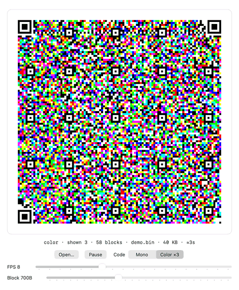

# QrTransfer

[English](#en) · [简体中文](#zh-cn)

## English {#en}

Send a file from your Mac to your iPhone with a stream of QR codes. Once both apps are installed, the transfer works with just your Mac’s screen and your iPhone’s camera.

### Build and install

- **Mac** · Build QrSender on macOS 13 or later.
- **iPhone** · Build and install QrReceiver for iOS 16 or later using Xcode.

See the [build instructions](https://github.com/QrTransfer/QrTransfer#build-from-source). Both apps must use QRT2.

### Send a file

1. Open or drop a small file into **QrSender** and click **Play**.
2. Open **QrReceiver**, allow camera access, and keep the entire QR code in view.
3. After verification, save or open the file in the iOS share sheet.

QrReceiver automatically detects **Mono** and **Color ×3**. Color mode can carry up to three QR payloads per image. If scanning stalls, switch to **Mono**, lower the frame rate, or reduce the block size.

QRT2 uses fountain coding so later QR codes can help recover missed data. QrReceiver verifies the recovered file with SHA-256.

## 简体中文 {#zh-cn}

用 Mac 屏幕播放二维码，在 iPhone 上扫码接收文件。两端应用安装后，传输只需 Mac 的屏幕和 iPhone 的摄像头。

### 构建和安装

- **Mac** · 在 macOS 13 或更新版本上构建 QrSender。
- **iPhone** · 用 Xcode 构建并安装 QrReceiver，手机需运行 iOS 16 或更新版本。

参见[中文构建说明](https://github.com/QrTransfer/QrTransfer/blob/main/README.zh-CN.md)。请使用同样支持 QRT2 的发送端和接收端。

### 传送文件

1. 在 **QrSender** 中打开或拖入一个小文件，点击 **Play**。
2. 打开 **QrReceiver**，允许访问相机，并把整个二维码保持在取景框内。
3. 校验完成后，在 iOS 分享面板中保存或打开文件。

QrReceiver 会自动识别 **Mono** 和 **Color ×3**。彩色模式每帧最多承载三路二维码数据。如果进度停住，可以切换到 **Mono**、降低帧率或缩小数据块。

QRT2 使用喷泉码，漏扫的内容可以通过后续二维码恢复。QrReceiver 用 SHA-256 校验恢复后的文件。

[Source code / 源码](https://github.com/QrTransfer/QrTransfer) · [Report an issue / 反馈问题](https://github.com/QrTransfer/QrTransfer/issues)
